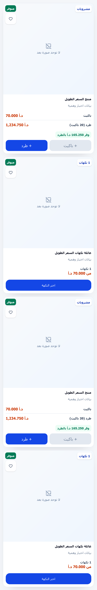
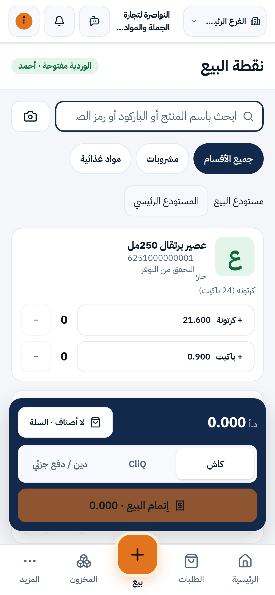

# عرض الأرقام اللاتينية

بقرار المالك 14 نوفمبر، بعد دمج #98 و#99: تعرض الواجهات الأرقام 0–9، والفاصلة العشرية ` . ` وفاصل الآلاف `,`، مع بقاء النص العربي و«د.أ».

سياسة العرض المشتركة هي `ar-JO-u-nu-latn` للمتجر والإدارة والتواريخ والوصل وواتساب. قيم الأسعار والكميات ولقطات الفواتير ومحللات الإدخال لم تتغير. Telegram يستخدم الأرقام اللاتينية بالفعل، وثبت ذلك باختبار formatter دون تعديل SQL أو Edge أو migration.

الفحوص المحلية قبل CI:

- وحدات المتجر: 230/230. اختبار السياسة يشمل 1,234.750 ودقة BigInt والتاريخ الأردني والنصوص الرقمية الوصفية، مع حارس AST سلبي للتنسيق العربي الضمني.
- المتصفح: 8 حالات الأرقام OFF/ON على Chromium وWebKit، بلمس وعرض 390px؛ إضافة إلى 18 حالة سابقة للأسعار والسلة والقص عند 320/390/1280. لقطة POS أدناه من شاشة الكاشير الفعلية، وليست صفحة قص الأسعار المصغرة ذات العمودين.
- HTTP223: 181 قراءة، منها 172 بنتائج و9 فارغة، وصفر أخطاء. RPC223: 732 حالة و18 رفض صلاحيات متوقعاً. أُعيدت أدلة المصدر والمواقع من التشغيل المعزول؛ SQL والكتالوج والصلاحيات لم تتغير.
- المنظوران التاريخيان 219، مخطط فقط وكامل، نجحا على 27bfd7b1 مع فحص المصدر والأدوار. كل beforeText وbefore-hash سابق محفوظ؛ الإسقاط لا يعمل إلا مع SHA مطابق، والبايت المجهول يبقى مكشوفاً.
- الجولة الأولى للوحدات الكاملة: 2058/2061. الإخفاقات توقعان رقميان قديمان ومقارنة مصدر Hero تاريخي. صُححت التوقعات الحرفية وأضيف الإسقاط الدقيق قبل المقارنة؛ الفحص المركّز بعدها 21/21، دون تعديل الحراس المالية أو الأصل التاريخي.
- فحصا الأنواع وstrict lint خرجت بصفر. البناءات الأربعة مع CSP وSEO وverify-dist نجحت. الميزانية: JavaScript أولي 676462 بايت، مضغوط 188768، وCSS مضغوط 17036، وصفر طلبات خطوط أولية، و5 طلبات JavaScript أولية.
- اكتشاف المتصفح: 2028 هوية = 762 أساسية +1266 موزعة على نفس 10 شعب، بلا تغيير مهلة أو إعادة أو عامل.

الصور بيانات اختبار وهمية. جميع HTTP وWebSocket الخاصة بـAPI محاكاة داخل المتصفح، مع حاجز نقل إضافي يمنع الاتصال بالتجربة. حجب الحاجز اتصالَي realtime في جولة POS أولية: لم تُعتبر 8/8 فيها شهادة كاملة. بعد إضافة محاكاة WebSocket نجحت الجولة كاملة مع صفر اتصال فعلي بالتجربة، والحاجز نفسه بلا تعديل.

نتيجة الوحدات الكاملة النهائية وروابط CI وGitleaks تُسجّل في وصف PR قبل التسليم. لا دمج أو نشر أو اتصال مستضاف، ولا تعديل لتجربة المالك أو ملفاته. الملف النهائي والأقسام مهمتان لاحقتان منفصلتان.
